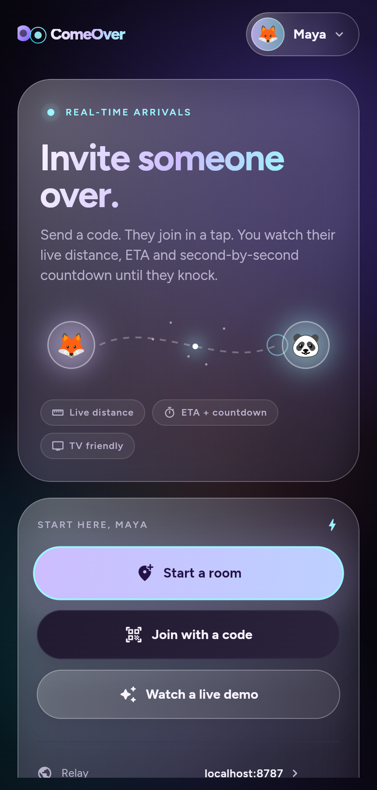
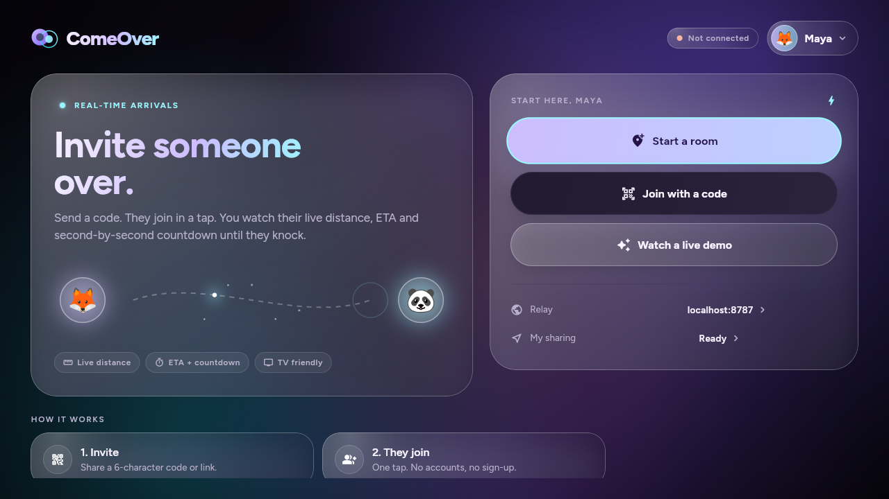
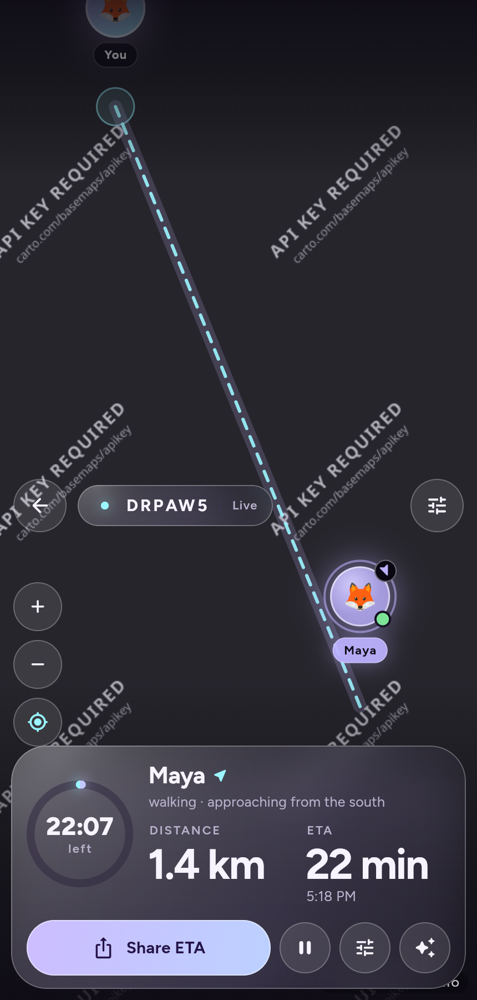
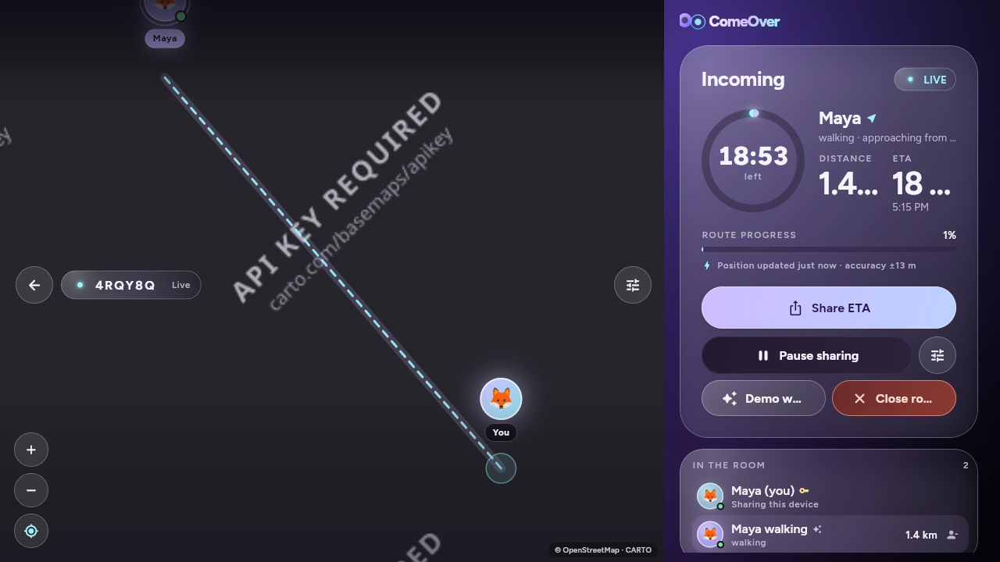

# ComeOver

Invite someone over. Watch them arrive.

ComeOver is a small, account-free app for the last few minutes of a visit. One person starts a
room and shares a six-character code (or a link). The other person joins, and both sides see a
live map with distance, ETA and a second-by-second countdown until they are at the door.

Built with a single Flutter codebase for **Android phones and tablets, Android TV, Fire TV and
iOS**, plus the web for quick demos. The relay is a self-hosted Node + Socket.IO server — no
accounts, no API keys, no cloud database.

## Preview

| Phone | TV |
| --- | --- |
|  |  |
|  |  |

Screenshots come from the web build in demo mode (`Watch a live demo`).

## What is in the box

- **Invite flow** — start a room, share a code/QR/link, the guest joins from a phone or types the
  code on a TV.
- **Live arrival screen** — full-bleed OpenStreetMap/CARTO map, moving traveller marker, dashed
  route, arrival radius, distance, ETA, countdown ring, route progress and stale-location hints.
- **10-foot TV UI** — d-pad focus rings, overscan-safe layout, remote hints, a map-based meeting
  point picker for TVs without GPS, and a wide HUD rail.
- **Material 3 Expressive (Android) + matured Liquid Glass (iOS)** — one codebase, two skins:
  Android (phones, tablets, Android TV and Fire OS) uses generated Material 3 Expressive colour
  roles, the Roboto Flex expressive typeface and springy stagehand motion; iOS and macOS use a
  restrained Liquid Glass treatment with graphite surfaces, hairline rims, deep backdrop blur,
  native SF type and Cupertino page transitions. The web build follows the browser's platform.
- **Lock-screen live status** — while a room is open, the arrival countdown stays visible on a
  locked phone: a Live Update chip on Android 16 (including the Samsung Now Bar) and a Live
  Activity with Dynamic Island on iOS 16.1+. The system ticks the countdown natively, so it keeps
  moving even between location updates.
- **Private by default** — rooms live in memory for six hours, invite codes are short-lived, the host
  can coarsen precision or set an arrival radius, and sharing can be paused at any time.
- **Demo mode** — a simulated walking/driving traveller so TVs, emulators and screenshots work
  without a second phone.

## Repository layout

```
comeover/
├── app/          Flutter client (phone, tablet, TV, web)
├── server/       Node + Socket.IO relay, dashboard and invite page
└── deploy/
    ├── umbrel/   Community app store package for UmbrelOS
    └── docker-compose.yml
```

## Quick start

### 1. Run the relay

```bash
cd server
npm install
npm run dev
```

The relay listens on `0.0.0.0:8787` (override with `PORT`). Check it with
`curl http://localhost:8787/healthz`. Opening `http://localhost:8787` shows a small relay
dashboard with the health, room count and the address to paste into the app's **Settings → Relay**.

### 2. Run the app

```bash
cd app
flutter pub get

# Phone/tablet emulator: the app already defaults to 10.0.2.2 on Android.
flutter run

# A physical phone on the same Wi-Fi as the relay:
flutter run --dart-define=COMEOVER_SERVER=http://192.168.1.20:8787
```

The server URL can also be changed at runtime from **Settings → Relay**; the value is stored
locally. `COMEOVER_PUBLIC_URL` controls the base of the invite links you share (defaults to the
relay URL).

### 3. Meet someone

1. Tap **Start a room** (or **Watch a live demo** for a simulated traveller).
2. Share the code, QR or invite link.
3. The guest joins, shares their location, and both screens switch to the live map.

On a TV, use the d-pad to pick a meeting point on the map, then press OK. The TV has no GPS, so it
measures arrivals from the host's shared position (or from the point you picked).

### Always-on hosting on UmbrelOS + Tailscale

The `deploy/` folder contains a Docker Compose setup, a complete Umbrel community app store package
and a step-by-step Tailscale guide. In short: publish the relay image, add the community store from
`deploy/umbrel`, install **ComeOver** on the Umbrel, put the box on your tailnet, build the app with
the tailnet URL, and share the Umbrel node with a guest from the Tailscale admin console. No router
port-forwarding is required.

See [deploy/umbrel/README.md](deploy/umbrel/README.md) for the packaged app and
[deploy/README.md](deploy/README.md) for the plain Compose/Tailscale path. The relay dashboard is
served at port `8788` behind Umbrel auth; companion apps use the direct relay port `8787` so they
can speak REST and Socket.IO without Umbrel login cookies.

## Configuration

Dart defines (pass with `--dart-define=NAME=value`):

| Define | Purpose | Default |
| --- | --- | --- |
| `COMEOVER_SERVER` | REST + Socket.IO relay base URL | web: page origin; Android: `http://10.0.2.2:8787`; others: `http://localhost:8787` |
| `COMEOVER_PUBLIC_URL` | Base URL used inside shared invite links | same as `COMEOVER_SERVER` |
| `COMEOVER_DEMO_LOCATION` | Fixed `lat,lng` used instead of GPS (great for TV/emulator) | unset |
| `COMEOVER_PREVIEW` | Skip permission prompts and simulated-data UI for screenshots | off |

The relay accepts `PORT`, `HOST`, `COMEOVER_VERSION` and `COMEOVER_DIRECT_PORT` environment
variables. `COMEOVER_DIRECT_PORT` is only used by the dashboard when it prints the address for the
native app.

## Builds

### Android / Fire TV

```bash
cd app
flutter build apk --release --dart-define=COMEOVER_SERVER=https://relay.example.com
```

The universal APK is at `app/build/app/outputs/flutter-apk/app-release.apk`. It contains the
location permissions, cleartext-traffic allowance for self-hosted HTTP relays, a TV banner, the
`LEANBACK_LAUNCHER` entry and the `comeover://join/CODE` intent filter.

Fire TV sideload:

```bash
adb connect <fire-tv-ip>:5555
adb install -r app/build/app/outputs/flutter-apk/app-release.apk
```

The app appears in the Fire TV apps row as **ComeOver**. Android TV shows it in the leanback
launcher. For production, sign the APK with your own keystore instead of the debug key.

### iOS

```bash
cd app
flutter pub get
open ios/Runner.xcworkspace
```

`Info.plist` already declares `NSLocationWhenInUseUsageDescription`, the `comeover` URL scheme and
an ATS exception for self-hosted HTTP relays. Replace the ATS exception with `NSExceptionDomains`
once your relay has a stable HTTPS hostname. An Apple developer team and a Mac/Xcode are required
to build and sign; this repository was developed on Linux, so the iOS target is code-complete but
not built here.

### Web

```bash
cd app
flutter build web --release \
  --dart-define=COMEOVER_SERVER=https://relay.example.com \
  --dart-define=COMEOVER_PUBLIC_URL=https://relay.example.com
```

Serve `app/build/web`. The web build reads `/j/CODE` invite links and geolocation works on secure
origins (`https` or `localhost`).

## Invite links

The relay renders a small page at `/j/<code>` with an **Open ComeOver** button pointing at
`comeover://join/<code>`. The client also understands:

- `https://relay.example.com/j/ABC123`
- `comeover://join/ABC123`
- `?code=ABC123` / `?invite=ABC123`
- `#join/ABC123`

Custom-scheme links are wired up on Android and iOS. To turn an HTTPS invite into a true universal
link, add an associated-domains entitlement and serve `apple-app-site-association` from your relay
domain, then add the matching `autoVerify` intent filter on Android.

## Relay API

| Method | Path | Purpose |
| --- | --- | --- |
| `GET` | `/` | Relay dashboard (status, room count, connection address) |
| `GET` | `/healthz` | Liveness and room count |
| `POST` | `/api/rooms` | Create a room (host) |
| `POST` | `/api/rooms/:code/join` | Join as a guest |
| `GET` | `/api/rooms/:code` | Peek at a room before joining |
| `POST` | `/api/rooms/:code/demo` | Start the simulated traveller (host only) |
| `POST` | `/api/rooms/:code/settings` | Update units/precision/arrival radius (host only) |
| `DELETE` | `/api/rooms/:code/members/:id` | Leave or remove a guest |
| `POST` | `/api/rooms/:code/end` | Close the room (host only) |
| `GET` | `/j/:code` | Invite landing page |

Realtime traffic runs over Socket.IO on the same port: member joins/leaves, presence, location
updates, settings changes and room-end events.

## Testing

```bash
# relay
cd server
npm test
npm run typecheck

# app
cd app
flutter analyze
flutter test
```

## Known limitations

- The relay is intentionally in-memory: restarting it drops every room. Put it behind a process
  manager and a persistent reverse proxy if you want it always available.
- Location sharing continues while a phone is locked because Android runs a foreground location
  service and iOS uses background location updates for the duration of a room. The relay still has
  to be reachable; if the phone loses the network, the map pauses until it reconnects.
- Android 16 Live Updates are requested through a promoted ongoing notification. The user (or their
  OEM skin) can disable promotion, in which case ComeOver falls back to an ongoing notification.
  Samsung One UI 8.x additionally requires **Live notifications for all apps** in developer options;
  One UI 9 / Android 17 enable third-party live notifications broadly.
- iOS Live Activities and the WidgetKit extension compile only with macOS/Xcode. The Swift sources
  and Xcode target are checked in, but they were not built on this Linux machine.
- The generated release APK is signed with the debug keystore so it can be sideloaded immediately.
  Use your own keystore for any real distribution.
- No physical TV was attached. The TV layout and d-pad flow are covered by widget tests and the web
  build, and the Android APK compiles, but validate launcher behaviour on your own Fire TV /
  Android TV hardware.

## Privacy notes

- Rooms are in-memory only and expire after six hours (or when the host closes them).
- No accounts, emails, phone numbers, analytics or third-party location services.
- Exact coordinates are relayed only to members of the room. The host can turn on approximate
  precision, and each device can pause sharing.
- Map tiles are fetched directly from CARTO/OpenStreetMap; the relay never proxies them.

ComeOver is a small self-hosted project: run the relay on a machine you control, put it behind
HTTPS if it is reachable from the internet, and keep the room code private.
